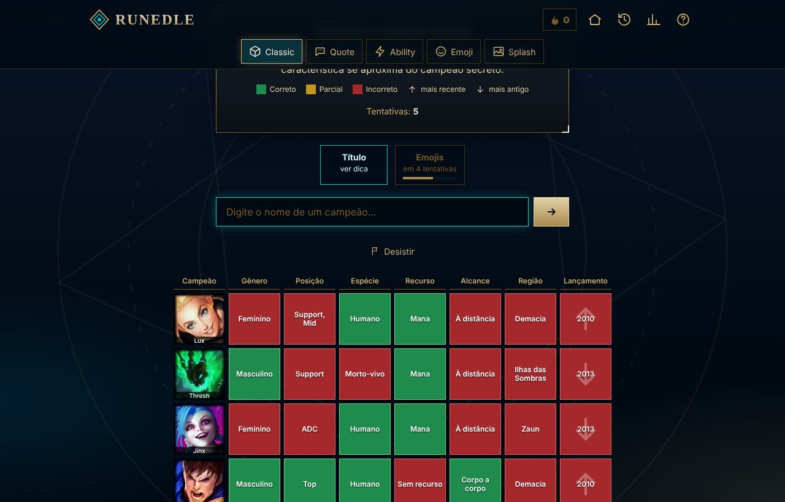
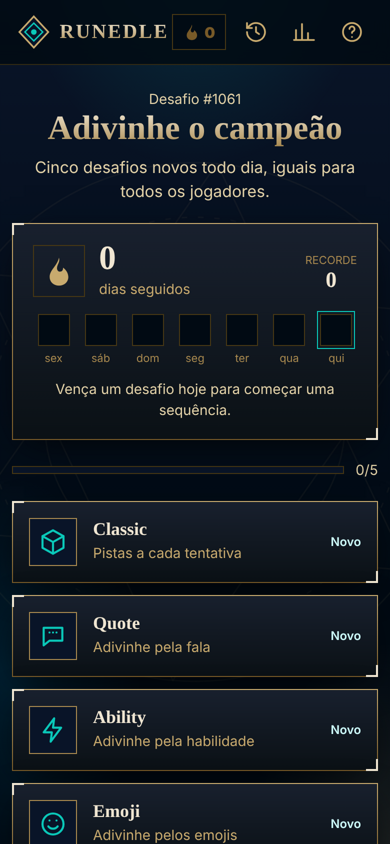
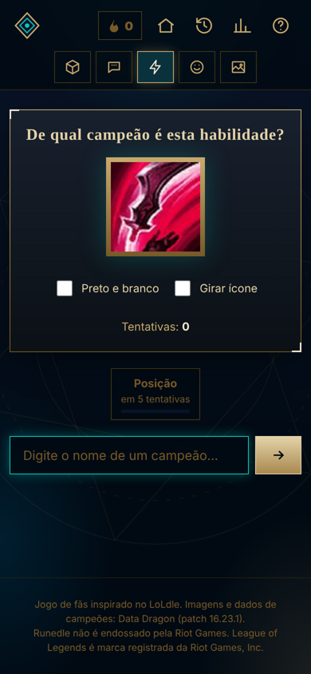

<div align="center">

# RUNEDLE

**Descubra o campeão de League of Legends do dia.**
Um jogo diário de adivinhação inspirado no LoLdle, feito com HTML, CSS e JavaScript puro.




</div>

## Sobre

Todo dia, às 21h (horário de Brasília), cada um dos cinco modos sorteia um campeão secreto.
O sorteio usa a data como semente, então **todos os jogadores recebem o mesmo campeão no mesmo dia**,
sem precisar de servidor.

O projeto não tem dependências nem etapa de build: basta abrir o `index.html`.

## Modos de jogo

| Modo | Como funciona |
| --- | --- |
| **Classic** | Cada palpite compara 7 características com o campeão secreto. Verde é igual, amarelo é parcial e vermelho é diferente. No ano de lançamento, uma seta indica se o secreto é mais novo ou mais antigo. |
| **Quote** | Descubra quem diz a frase mostrada. |
| **Ability** | Identifique o campeão pelo ícone de uma habilidade (Q, W, E ou R). Dá para jogar em preto e branco ou com o ícone girado, e há um bônus para acertar a tecla (revelada só depois da resposta). |
| **Emoji** | Uma sequência de emojis representa o campeão. Cada erro revela mais um. |
| **Splash** | Um trecho ampliado da splash art de uma skin sorteada, em preto e branco por padrão. Cada erro afasta o zoom, e há um bônus para acertar a skin. |

## Funcionalidades

- ♾️ **Modo infinito**: rodadas aleatórias sem limite, em um modo escolhido ou sorteado, com sequência e recorde próprios.
- 📅 **Calendário**: jogue o desafio de qualquer dia passado (não conta para a sequência diária).
- 🔥 **Sequência diária**: dias seguidos em que você venceu pelo menos um desafio, com recorde e os últimos 7 dias.
- 📊 **Estatísticas por modo**: partidas, vitórias, taxa de vitória, sequência atual, maior sequência e distribuição de tentativas.
- 🕓 **Histórico** das partidas e **contagem regressiva** para o próximo desafio.
- 🔎 **Autocompletar** com ícones, navegação pelo teclado e bloqueio de palpites repetidos.
- 💡 **Dicas** liberadas conforme você erra e opção de **desistir**.
- 📤 **Compartilhar** o resultado em emojis, como no Wordle.
- 📱 **Responsivo**, com animações que respeitam `prefers-reduced-motion`.
- ✈️ **Funciona offline**: ícones, habilidades e splash padrão ficam no repositório. Com internet, o modo Splash busca as skins no Data Dragon.

<div align="center">
  
  &nbsp;&nbsp;
  
</div>

## Como rodar

```bash
git clone https://github.com/EricHafemann/RUNEDLE.git
cd RUNEDLE
```

Abra o `index.html` no navegador. Se preferir rodar com um servidor local:

```bash
npx serve .        # ou: python -m http.server 8000
```

### Publicar no GitHub Pages

1. No repositório, vá em **Settings → Pages**.
2. Em **Source**, escolha **Deploy from a branch**, branch `main` e pasta `/ (root)`.
3. O jogo fica disponível em `https://erichafemann.github.io/RUNEDLE/`.

## Estrutura

```
RUNEDLE/
├── index.html          # Estrutura da página
├── css/
│   └── style.css       # Tema, layout responsivo e animações
├── js/
│   ├── data.js         # Atributos dos campeões, emojis, falas e títulos
│   ├── icons.js        # Ícones dos campeões (embutidos em base64)
│   └── app.js          # Lógica do jogo
├── spells/             # Habilidades de cada campeão (carregadas sob demanda)
├── splash/             # Splash arts (carregadas sob demanda)
└── docs/screenshots/   # Imagens deste README
```

### Como o `app.js` está organizado

| Seção | Responsabilidade |
| --- | --- |
| Desafio diário | Hash determinístico (cyrb53) da data + modo, gerador com semente (mulberry32) e contagem até as 21h (00:00 UTC). |
| LocalStorage | Partida do dia, estatísticas por modo, sequência diária e histórico. |
| Comparação | Regras de acerto total, parcial ou erro do modo Classic. |
| Sessões | Desafio do dia, dia do calendário e modo infinito com a mesma interface de jogo. |
| Modos | Configuração de cada modo: sorteio, pista, dicas, bônus e texto de compartilhamento. |
| Renderização | Telas, busca com autocompletar, modais e animação de vitória. |

## Dados

- **Imagens, nomes e títulos** vêm do [Data Dragon](https://developer.riotgames.com/docs/lol#data-dragon) da Riot Games, patch 16.23.1. As skins do modo Splash são carregadas do Data Dragon quando há internet.
- **Gênero, posições, espécie, recurso, alcance, região e ano** não existem no Data Dragon e foram catalogados manualmente em `js/data.js`.
  Correções são bem-vindas: cada campeão é uma linha.

## Aviso legal

RUNEDLE é um projeto de fã, sem fins lucrativos, e não é endossado pela Riot Games.
League of Legends e todos os personagens, imagens e marcas relacionados são propriedade da Riot Games, Inc.
Inspirado no [LoLdle](https://loldle.net).

O código está sob a [licença MIT](LICENSE). Os assets da Riot não estão incluídos nessa licença.
